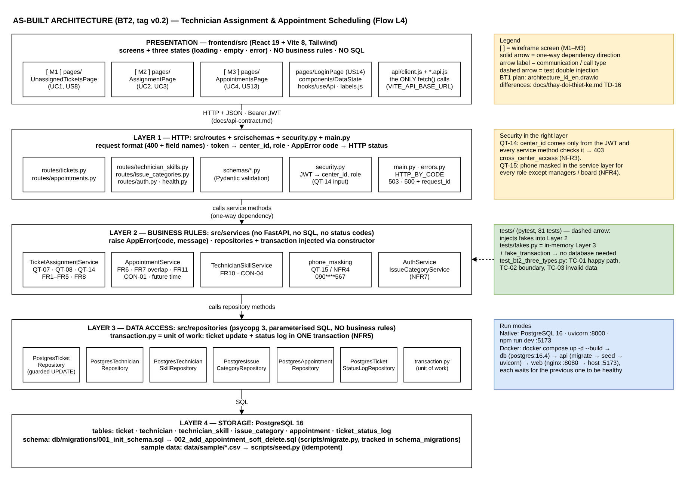

# `docs/architecture-thuc-te.md` — Architecture as built (L4, BT2, tag v0.2)

This is the architecture that is **actually implemented** at tag `v0.2`.
The BT1 design (planned) is `docs/architecture_l4_en.md`; every difference is recorded
in `docs/thay-doi-thiet-ke.md` (TD-16 summarises the structural ones).



Diagram source: `docs/architecture-thuc-te.drawio` (open in draw.io; PNG export in `docs/exports/`).

## 1. Layers and where they live

| Layer | Folder / files | Responsibility | Must not |
|---|---|---|---|
| Presentation (browser) | `frontend/src/pages/` (M1 `UnassignedTicketsPage`, M2 `AssignmentPage`, M3 `AppointmentsPage`, `LoginPage`), `frontend/src/components/`, `frontend/src/hooks/useApi.js`, `frontend/src/labels.js` | Render screens and the three states (loading · empty · error) | Call `fetch` directly; hold business rules |
| API client | `frontend/src/api/client.js`, `*.api.js`, `session.js` | Base URL from `VITE_API_BASE_URL`, token header, translate error codes to Vietnamese messages, end session on 401 | Be bypassed by pages |
| 1 · HTTP | `src/routes/*.py`, `src/schemas/*.py`, `src/security.py`, `src/main.py` | Parse/validate the request format (Pydantic → 400 with field names), read `center_id`/`role` from the JWT, wire services to repositories, translate `AppError.code` → HTTP status (`src/errors.py: HTTP_BY_CODE`), 503 on database outage | Contain business rules or SQL |
| 2 · Business rules | `src/services/*.py` | QT-07, QT-08, QT-14 center checks, QT-15 masking, FR7 overlap, CON-01, appointment lifecycle limits; raise `AppError(code, message)` | Import anything from FastAPI/HTTP or the database driver; know status codes |
| 3 · Data access | `src/repositories/*.py`, `src/db.py` | Parameterised SQL with psycopg 3; `transaction.py` groups writes in one transaction | Decide anything (no business `if`) |
| Data store | PostgreSQL 16 · `db/migrations/001_init_schema.sql`, `002_add_appointment_soft_delete.sql` · seed `data/sample/` | PK/FK/CHECK (CON-01…06), partial indexes for NFR1/NFR2/FR7 | — |

Dependencies point one way only: `routes → services → repositories → db`.
Services receive their repositories (and the transaction factory) through the
constructor, so `tests/fakes.py` can replace layer 3 and every test runs without PostgreSQL.

Quick checks used before submission:

```bash
grep -rnE "fastapi|status_code|psycopg|get_connection|SELECT" src/services/   # → nothing
grep -rn  "fetch(" frontend/src/pages frontend/src/components                 # → nothing
```

## 2. One request through the layers (assign a technician, UC3)

1. `AssignmentPage` → `ticketsApi.assignTechnician()` → `POST /api/tickets/{id}/assignment` with the Bearer token.
2. `routes/tickets.py` validates the body (`AssignmentCreate`), reads `center_id` and `user_id` from the token, calls the service.
3. `TicketAssignmentService.assign_technician()` checks center (QT-14), ticket state, technician active + same center + proficiency ≥ 3 (QT-08); then inside `with self.transaction() as tx:` updates the ticket and writes `ticket_status_log` (NFR5).
4. `PostgresTicketRepository.assign_technician()` runs a guarded `UPDATE … WHERE status = 'MOI' AND technician_id IS NULL`; zero rows → the service raises `ticket_not_assignable` and the transaction rolls back.
5. Any `AppError` becomes JSON `{error, message, details?}` with the status from `HTTP_BY_CODE`; the page shows the Vietnamese message for that code.

## 3. NFR → implementation

| NFR | Where it is implemented |
|---|---|
| NFR1 list < 2 s / 500 tickets | Server-side filter, sort and `LIMIT/OFFSET` in `PostgresTicketRepository.list_unassigned`; partial index `idx_ticket_unassigned` |
| NFR2 suggestion < 1 s | One indexed query in `PostgresTechnicianRepository.list_qualified_for_category` (`idx_skill_lookup`) |
| NFR3 cross-center → 403 | `center_id` only from the JWT (`security.py`), checked in every service method (`cross_center_access`) |
| NFR4 phone masking | `services/phone_masking.py`, tests in `tests/test_phone_masking.py` |
| NFR5 all-or-nothing | `repositories/transaction.py` + guarded UPDATE; failure ⇒ rollback, no log row |
| NFR7 new category = 1 INSERT | Categories read from `issue_category` (`GET /api/issue-categories`), no enum in code |

## 4. Runtime and packaging

| Mode | Components |
|---|---|
| Native (README steps) | PostgreSQL 16 · `uvicorn src.main:app` on :8000 · `npm run dev` on :5173 |
| Docker (`docker compose up -d --build`) | `db` (postgres:16.4-alpine, healthcheck) → `api` (Dockerfile, runs migrate → seed → uvicorn, healthcheck `/health`) → `web` (frontend/Dockerfile, nginx on :8080 published as :5173) |

Configuration comes only from environment variables (`.env.example`, `frontend/.env.example`).
